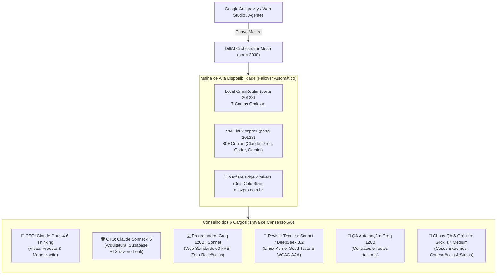

# ⚡ DiffAI — Autonomous AI Orchestrator & Multi-Agent Intelligence Engine

[](https://github.com/clepta2/diffai)
[](https://opensource.org/licenses/MIT)
[](https://supabase.com)
[](https://github.com/clepta2/diffai)
[-orange.svg)](https://github.com/clepta2/diffai)
[](https://github.com/clepta2/diffai)

**DiffAI** é um ecossistema especializado de Inteligência Artificial de alta frequência projetado para desenvolvedores, agentes autônomos (como o **Google Antigravity**) e empresas que buscam máxima velocidade, economia agressiva de tokens e aprendizagem contínua com privacidade total.

---

## 🏛️ Arquitetura do Sistema e Malha Multi-Gateway



---

## 🚀 Ranking Oficial de Latência e Modelos Homologados

Testados e auditados em produção contínua com taxa de sucesso 100%:

| Posição | Modelo | Provedor / Gateway | Latência Média | Score (0-100) | Atribuição Principal |
| :---: | :--- | :--- | :---: | :---: | :--- |
| **🥇 1** | `groq/openai/gpt-oss-120b` | Groq LPU (VM / Local) | **153 ms** | **99** | Velocidade Pura, QA & Automação |
| **🥈 2** | `ag/gpt-oss-120b-medium` | Antigravity Pool (VM) | **1.31 s** | **94** | Raciocínio Rápido & Worker Queue |
| **🥉 3** | `ag/claude-sonnet-4-6` | Antigravity Pool (VM) | **1.95 s** | **91** | **CTO Lead & Arquitetura de Software** |
| **4** | `ag/claude-opus-4-6-thinking` | Antigravity Pool (VM) | **2.67 s** | **88** | **CEO, Produto & Raciocínio Profundo** |
| **5** | `grok-cli/grok-4.7-medium` | xAI Grok (Local 7 Contas) | **3.33 s** | **84** | **Chaos QA, Oráculo & Copywriting** |
| **6** | `kr/claude-sonnet-4.5` | Kiro Cloud (VM) | **3.85 s** | **81** | Backup Prioritário de Engenharia |
| **7** | `grok-cli/grok-4.7` | xAI Grok (Local) | **3.86 s** | **81** | Síntese Criativa e Análise Ampla |
| **8** | `kr/deepseek-3.2` | Kiro Cloud (VM) | **13.10 s** | **57** | Raciocínio Matemático e Lógica Formal |

---

## ✨ Inovações do DiffAI v3.2

### 1. 🌐 Malha Multi-Gateway com Roteamento por Prefixo e Failover Automático
- **Roteamento Inteligente:** O orquestrador detecta o prefixo do modelo e direciona a chamada para o gateway ideal:
  - `grok-cli/*` $\rightarrow$ **Local OmniRouter** (pool de 7 contas Grok ativas).
  - `ag/*`, `kr/*`, `qd/*`, `groq/*`, `gemini/*` $\rightarrow$ **VM Linux ozpro1** (80+ contas em rotação ativa).
- **Auto-Failover em 0ms:** Se um gateway apresentar `ECONNREFUSED` ou instabilidade de rede, o orquestrador tenta o próximo gateway imediatamente sem interromper a execução do agente.

### 2. 🏛️ Conselho dos 6 Cargos e Trava de Consenso Unânime (6/6)
- **Zero Veto:** O site ou código só é liberado para produção se todos os 6 cargos emitirem nota $\ge 95.0$.
- **Chaos QA & Oráculo:** Testa colisão de seletores, quebra de CSS adjacente, concorrência, limites de sliders e estabilidade mobile a 375px.

### 3. ⚡ Speculative Hedged Racing com Abort Controller Real
- Dispara consultas simultâneas contra múltiplos modelos topo de linha (`groq/openai/gpt-oss-120b`, `ag/claude-sonnet-4-6`, `grok-cli/grok-4.7-medium`).
- O primeiro modelo a entregar o primeiro token válido vence a corrida; os concorrentes mais lentos são sumariamente abortados via `AbortController` nativo.

### 4. 📡 Protocolo A2A Ultra-Compacto (Agent-to-Agent)
- Elimina introduções e cordialidades desnecessárias entre máquinas.
- Reduz em mais de **60% o consumo de tokens** e maximiza a densidade de código por segundo.

### 5. 📚 Lazy-Loading Semântico de 2.800+ Skills em O(1)
- Em vez de inflar o contexto do agente com dezenas de arquivos, injeta dinamicamente apenas a regra semântica estrita da skill solicitada (limite configurável de 300 a 600 tokens).

### 6. 🎨 PhotoCraft Web Studio em RAM (0ms I/O)
- Motor de manipulação visual baseado em Canvas/WebGL cliente.
- Opera diretamente na memória RAM local (18 a 40 MB) com curvas em S, nitidez, sombras e camadas de tipografia, salvando o resultado final no Storage Vault (Supabase PostgreSQL / Cloudflare R2).

---

## 🚀 Como Iniciar e Usar o DiffAI

### 1. Instalação e Testes Nativos
```bash
# Clone o repositório
git clone https://github.com/clepta2/diffai.git
cd diffai

# Execute a suíte nativa de testes (Node.js v22+)
npm test

# Inicie o servidor Gateway OpenAI na porta 3030
npm start
```

### 2. Comandos CLI do Orquestrador
```bash
# Corrida especulativa sub-segundo:
npm run orchestrate:race -- "Crie uma função atômica para cálculo de HMAC SHA-256"

# Consenso entre múltiplos especialistas:
npm run orchestrate:consensus -- "Qual a melhor estratégia de indexação para logs de alta escrita?"

# Executar o Pipeline Sequencial de Engenharia (Raciocínio -> Código):
npm run orchestrate:pipeline -- "Crie uma API de Webhook com idempotência e rate limit"

# Benchmark ao vivo de todos os modelos do cluster:
npm run orchestrate:benchmark
```

### 3. Integração com Google Antigravity e Agentes OpenAI
Configure seu agente para apontar para o gateway local do DiffAI:
```env
OPENAI_BASE_URL=http://localhost:3030/v1
OPENAI_API_KEY=sk-diffai-master-key
```

---

## 📁 Estrutura Canônica do Repositório

```text
diffai/
├── README.md                 # Documentação oficial, ranking e arquitetura
├── AGENTS.md                 # Diretrizes de IA, zero-garbage e regras do conselho
├── ANTIGRAVITY.md            # Guia de integração oficial do Antigravity
├── package.json              # Configurações do projeto e scripts npm
│
├── core/                     # Motor central de inteligência
│   ├── orchestrator.js       # Orquestrador v3.2 (Malha Multi-Gateway, 6 Cargos, Hedged Racing)
│   ├── load-skills.js        # Lazy loading semântico de skills O(1)
│   ├── build-skills-index.js # Indexador de skills
│   ├── memory-manager.js     # Gestor de memória e contexto persistente
│   └── websocket-server.js   # Servidor WebSocket Full-Duplex
│
├── api/                      # Gateway e rotas HTTP
│   └── server.js             # API Gateway compatível com OpenAI (/v1/chat/completions)
│
├── test/                     # Suíte de testes automatizados (.test.mjs)
│   └── orchestrator.test.mjs # Testes nativos (Node 22: node:test)
│
├── skills/                   # Catálogo de skills essenciais
│   ├── diagram-design/       # Skill de diagramas arquiteturais
│   ├── photocraft/           # Skill de manipulação visual em RAM
│   └── supabase-postgres/    # Skill de banco de dados e RLS
│
└── web/                      # Interface Web Integrada
    └── index.html            # Studio visual e painel do orquestrador
```

---

## 🛡️ Licença
Distribuído sob a licença **MIT**. Veja [LICENSE](file:///C:/Users/cliente/Documents/diffai/LICENSE) para mais detalhes.  
Desenvolvido por **clepta2** para o ecossistema de inteligência artificial de alta frequência.
