# ⚡ DiffAI — Autonomous AI Orchestrator & Multi-Agent Intelligence Engine

[](https://github.com/clepta2/diffai)
[](https://opensource.org/licenses/MIT)
[](https://supabase.com)
[](https://github.com/clepta2/diffai)
[-blueviolet.svg)](https://github.com/clepta2/diffai)
[-orange.svg)](https://github.com/clepta2/diffai)
[](https://github.com/clepta2/diffai)

**DiffAI** é um ecossistema especializado de Inteligência Artificial de alta frequência projetado para desenvolvedores, agentes autônomos (como o **Google Antigravity**) e empresas que buscam máxima velocidade, engenharia de software de padrão Tier-1 (Linux, Cloudflare, Amazon, Microsoft, NVIDIA, OpenAI) e esteira autônoma 24/7.

---

## 🏛️ Matriz Canônica de 16 Agentes Autônomos em Tempo Real (SWARM-16)

Diferente de esteiras sequenciais lineares (waterfall / cascata), o DiffAI implementa o **Actor Model Concorrente com Barramento A2A (Agent-to-Agent)**:
- **16 Agentes Autônomos operam SIMULTANEAMENTE desde o segundo zero**.
- **8 Agentes Criadores** (Executores de Alta Performance) pareados com **8 Agentes Revisores Dedicados** (Supervisão Cruzada & Poder de Veto Especializado).
- **Trava de Consenso Unânime 16/16 Inegociável**: o sistema só é liberado para deploy se **todos os 16 agentes** emitirem nota individual $\ge 95.0$, a Média Harmônica ponderada $IQS \ge 95.0$ e houver **zero vetos ativos**.

```mermaid
flowchart TD
    Client["Google Antigravity / Web Studio / Agentes"] -->|Chave Mestre| DiffAIGateway["DiffAI Gateway (porta 3030)"]

    subgraph A2ABus["Barramento Descentralizado A2AMessageBus (Event-Driven Co-Thinking)"]
        direction LR
        A2AEvents["A2A_PROPOSAL | A2A_ARCH | A2A_QUERY | A2A_RESPONSE | A2A_CHALLENGE | A2A_CROSS_VETO | A2A_CONSENSUS_VOTE"]
    end

    DiffAIGateway --> A2ABus

    subgraph Swarm16["Matriz Canônica de 16 Agentes Concorrentes no Segundo Zero"]
        direction TB

        subgraph Pair1["Par 1: Produto & Monetização"]
            C1["👔 C1: CEO Visionário\n(groq/openai/gpt-oss-120b)"] <-->|A2A| R1["🧐 R1: CEO Reviewer\n(kr/claude-sonnet-4.5)"]
        end

        subgraph Pair2["Par 2: Arquitetura & Governança"]
            C2["🛡️ C2: CTO Arquiteto\n(ag/claude-opus-4-6-thinking)"] <-->|A2A| R2["🔍 R2: CTO Reviewer RLS\n(kc/deepseek-r1:free)"]
        end

        subgraph Pair3["Par 3: Engenharia Full-Stack"]
            C3["💻 C3: Lead Programmer 60 FPS\n(qd/qfmodel)"] <-->|A2A| R3["📐 R3: Programmer Reviewer\n(ag/claude-sonnet-4-6)"]
        end

        subgraph Pair4["Par 4: Padrão Linux Kernel"]
            C4["🐧 C4: Senior Reviewer Kernel\n(ag/claude-sonnet-4-6)"] <-->|A2A| R4["♿ R4: Reviewer WCAG & CSS\n(kc/deepseek-r1:free)"]
        end

        subgraph Pair5["Par 5: QA Automação & Contratos"]
            C5["🧪 C5: QA Automation Tester\n(gemini/gemini-3.5-flash-lite)"] <-->|A2A| R5["📊 R5: Tester Reviewer Graph\n(qd/qfmodel)"]
        end

        subgraph Pair6["Par 6: Chaos QA & Casos Extremos"]
            C6["🔬 C6: Chaos QA Oracle\n(kc/deepseek-r1:free)"] <-->|A2A| R6["⚡ R6: Chaos Reviewer Stress\n(ag/claude-opus-4-6-thinking)"]
        end

        subgraph Pair7["Par 7: Red Team Adversarial (Quarentena)"]
            C7["🏴‍☠️ C7: Red Team Bug Bounty\n(kr/deepseek-3.2)"] <-->|A2A| R7["⚖️ R7: Red Reviewer CVSS\n(ag/claude-sonnet-4-6)"]
        end

        subgraph Pair8["Par 8: Blue Team Sentinel (Guardião)"]
            C8["🛡️ C8: Blue Team Sentinel\n(ag/claude-opus-4-6-thinking)"] <-->|A2A| R8["🔒 R8: Blue Reviewer Anti-Tamper\n(kc/qwen-2.5-coder-32b:free)"]
        end
    end

    A2ABus --> Swarm16
    Swarm16 -->|Voto 16/16 IQS >= 95.0| DeployApproved["🚀 Sistema 100% Homologado para Produção"]
    Swarm16 -.->|Veto Isolado de Qualquer Cargo| VetoBlock["⛔ Deploy Bloqueado (Auto-Cura Cirúrgica até 100x)"]
```



---

## 📋 Detalhamento dos 8 Pares Especialistas (16 Agentes)

| Par | Cargo Criador | Função & Responsabilidade | Cargo Revisor | Critérios de Auditoria & Veto |
| :---: | :--- | :--- | :--- | :--- |
| **1** | **👔 CEO (Visão & Produto)** | DNA de marca, slogan, proposta de valor, precificação e fim da paralisia de prompt. | **CEO Reviewer** | Viabilidade de CAC/LTV, clareza do pitch de vendas e sustentabilidade de MRR. |
| **2** | **🛡️ CTO (Arquitetura & Segurança)** | Supabase PostgreSQL RLS estrito por `company_id`, `window.SITE_CONFIG` congelado, Zero-Leak. | **CTO Reviewer** | Zero chaves em frontend, isolamento multi-tenant real e contratos imutáveis. |
| **3** | **💻 Lead Programmer** | Web Standards nativos (HTML5+ESModules+Tailwind+SVG), 60 FPS, blindagem Zero Naked HTML. | **Programmer Reviewer** | Sintaxe Node VM (`node -c`), zero comentários `// TODO`, zero reticências ou stubs. |
| **4** | **🐧 Senior Reviewer** | Padrão Linux Kernel (Linus Torvalds: Good Taste), indentação $\le 3$, funções puras. | **Reviewer Reviewer** | Contraste WCAG AAA, anti-sabotagem CSS (harmonia tema claro/escuro sem `!important`). |
| **5** | **🧪 QA Automação** | Call graph bidirecional (100% dos IDs DOM no HTML e contratos válidos nas rotas backend). | **Tester Reviewer** | Cobertura total de fluxos, testes nativos `.test.mjs` executando em $<2\text{ms}$. |
| **6** | **🔬 Chaos QA & Oráculo** | Casos de borda: clamping determinístico de sliders, prevenção de double-clicks, mobile 375px. | **Chaos QA Reviewer** | Resiliência concorrente, estresse de rede e degradação graciosa sem deadlocks. |
| **7** | **🏴‍☠️ Red Team Adversarial** | *Ex-Funcionário Hostil*: opera em sandbox quarentenada buscando bypass de RLS, SQLi e CSP. | **Red Team Reviewer** | Elimina falsos-positivos, valida reprodutibilidade dos exploits e calcula CVSS. |
| **8** | **🛡️ Blue Team Sentinel** | Guardião anti-backdoor: fiscaliza o Red Team e garante quarentena absoluta dos scripts de ataque. | **Blue Team Reviewer** | Trava anti-tamper (`SEC-TERMS-403`), conformidade com `_headers` CSP e zero-leak de scripts. |

---

## 🚀 Ranking Oficial de Latência e Modelos Homologados

Testados e auditados em produção contínua com taxa de sucesso 100%:

| Posição | Modelo | Provedor / Gateway | Latência Média | Score (0-100) | Atribuição Principal no Swarm |
| :---: | :--- | :--- | :---: | :---: | :--- |
| **🥇 1** | `groq/openai/gpt-oss-120b` | Groq LPU (VM / Local) | **153 ms** | **99** | **CEO (Velocidade Sub-segundo & Produto)** |
| **🥈 2** | `ag/gpt-oss-120b-medium` | Antigravity Pool (VM) | **700 ms** | **94** | Raciocínio Rápido & Worker Queue |
| **🥉 3** | `ag/claude-sonnet-4-6` | Antigravity Pool (VM) | **1.15 s** | **95** | **Programmer Reviewer & Senior Reviewer** |
| **4** | `ag/claude-opus-4-6-thinking` | Antigravity Pool (VM) | **1.56 s** | **96** | **CTO Arquiteto & Blue Team Sentinel** |
| **5** | `kr/claude-sonnet-4.5` | Kiro Cloud (VM) | **1.92 s** | **92** | **CEO Reviewer & Backup de Alta Estabilidade** |
| **6** | `qd/qfmodel` | Qoder Pool (VM) | **2.10 s** | **93** | **Lead Programmer (Web Standards 60 FPS)** |
| **7** | `grok-cli/grok-4.7-medium` | xAI Grok (Local 7 Contas) | **3.33 s** | **88** | Análise Ampla & Copywriting |
| **8** | `kr/deepseek-3.2` | Kiro Cloud (VM) | **4.80 s** | **91** | **Red Team Adversarial & Bug Bounty** |
| **9** | `kc/deepseek-r1:free` | Kilo Code (Free Route) | **2.40 s** | **94** | **CTO Reviewer & Chaos QA Oracle** |
| **10** | `gemini/gemini-3.5-flash-lite` | Gemini AI Studio Pool | **790 ms** | **92** | **QA Automation Engineer (Call Graph Rápido)** |

---

## ✨ Recursos de Engenharia de Software Tier-1

### 1. ⚡ Execução Concorrente Estrita no Segundo Zero (Zero Cascata)
O sistema dispara simultaneamente todas as 16 IAs autônomas via `Promise.all` e barramento de eventos:
```javascript
const { runRealtimeSwarm16 } = require('./core/orchestrator');

const result = await runRealtimeSwarm16({
  niche: 'SaaS de Telemedicina e Prontuário Eletrônico'
});

console.log(result.summary);
// => Consenso Unânime 16/16 Aprovado (IQS: 98.8/100 | 4ms)
```

### 2. 🛡️ Trava de Consenso Unânime 16/16 e Média Harmônica (IQS)
A qualidade é calculada matematicamente pela Média Harmônica Ponderada:
$$IQS = \frac{16}{\sum_{i=1}^{16} \frac{1}{\max(1, S_i)}}$$
Notas baixas ou vetos em qualquer um dos 16 agentes derrubam drasticamente a nota geral e bloqueiam o deploy compulsoriamente.

### 3. 🏴‍☠️ Doutrina do Ex-Funcionário Hostil & Quarentena Absoluta
- **Red Team isolado em sandbox**: Testa ataques reais (RLS bypass, SQL injection, CSP bypass) sem conversar com outros agentes.
- **Blue Team Sentinel**: Fiscaliza o Red Team em tempo real impedindo inserção de backdoors.
- **Quarentena estrita**: Scripts de ataque NUNCA são commitados ou entregues no bundle final do cliente (`audit/security-redteam/`).

### 4. 🌐 Malha Multi-Gateway com Failover Automático em 0ms
- `grok-cli/*` $\rightarrow$ **Local OmniRouter** (pool de 7 contas ativas na porta `20128`).
- `ag/*`, `kr/*`, `qd/*`, `groq/*`, `gemini/*`, `kc/*` $\rightarrow$ **VM Linux ozpro1** (`100.98.113.39:20128`).
- Se houver `ECONNREFUSED`, o orquestrador executa failover instantâneo para o próximo nó disponível.

---

## 🚀 Como Iniciar e Usar o DiffAI

### 1. Instalação e Testes Nativos
```bash
# Clone o repositório
git clone https://github.com/clepta2/diffai.git
cd diffai

# Execute a suíte nativa de testes (Node.js v22+)
npm test

# Inicie o servidor Gateway OpenAI na porta 3030
npm start
```

### 2. Comandos CLI do Orquestrador
```bash
# Matriz Canônica de 16 Agentes em Tempo Real (Zero Cascata):
npm run orchestrate:swarm16 -- "SaaS de Logística e Fretes"

# Corrida especulativa sub-segundo com cancelamento do concorrente lento:
npm run orchestrate:race -- "Crie uma função atômica para cálculo de HMAC SHA-256"

# Consenso entre múltiplos especialistas:
npm run orchestrate:consensus -- "Qual a melhor estratégia de indexação para logs de alta escrita?"

# Executar o Pipeline Sequencial de Engenharia:
npm run orchestrate:pipeline -- "Crie uma API de Webhook com idempotência e rate limit"

# Benchmark ao vivo de todos os modelos do cluster:
npm run orchestrate:benchmark
```

### 3. Integração com Google Antigravity e Agentes OpenAI
Configure seu agente para apontar para o gateway local do DiffAI:
```env
OPENAI_BASE_URL=http://localhost:3030/v1
OPENAI_API_KEY=sk-diffai-master-key
```

---

## 📁 Estrutura Canônica do Repositório

```text
diffai/
├── README.md                 # Documentação oficial, ranking e arquitetura do Swarm-16
├── AGENTS.md                 # Diretrizes de IA, zero-garbage e regras do conselho
├── ANTIGRAVITY.md            # Guia de integração oficial do Antigravity
├── package.json              # Configurações do projeto e scripts npm
│
├── core/                     # Motor central de inteligência
│   ├── orchestrator.js       # Orquestrador v3.3 (Swarm-16, A2ABus, 8 Pares, Hedged Racing)
│   ├── load-skills.js        # Lazy loading semântico de skills O(1)
│   ├── build-skills-index.js # Indexador de skills
│   ├── memory-manager.js     # Gestor de memória e contexto persistente
│   └── websocket-server.js   # Servidor WebSocket Full-Duplex
│
├── api/                      # Gateway e rotas HTTP
│   └── server.js             # API Gateway compatível com OpenAI (/v1/chat/completions)
│
├── test/                     # Suíte de testes automatizados (.test.mjs)
│   └── orchestrator.test.mjs # 10 Testes nativos (Node 22: node:test)
│
└── skills/                   # Catálogo de skills essenciais
```

---

## 📄 Licença
Distribuído sob licença MIT. Consulte `LICENSE` para mais detalhes.
Desenvolvido para o ecossistema **OZPro** e **Google Antigravity**.
